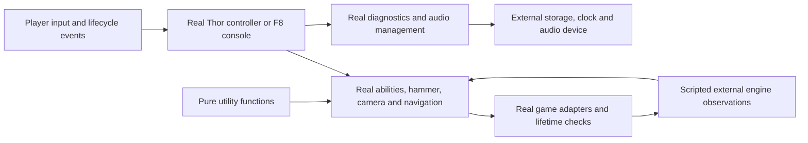

# Engine contracts and offline assurance

The production mod consumes typed capabilities from `GameServices`. Tests run
the same behavior and the real native argument-mapping adapters, with scripted
engine observations at the lowest boundary. They do not implement a second
recall algorithm, move objects according to velocity, or predict GTA physics.

The suite has two test categories. `PureFunction` covers deterministic utility
calculations, parsing and formatting with explicit inputs and no side effects.
`PlayerIntegration` drives player controls, console commands, frames, character
changes and reloads through the real mod composition. There are no isolated
stateful module tests, fake ability/logger probes, or standalone adapter tests.

The test harness assembles the same `ThorComposition` and `GtaRuntime` factories
as the shipped entry points. The script entry points select live primitive
bindings; tests select explicit external observations. Native argument mapping,
output assembly and confirmed deletion remain production code in both paths.
Tests assert these contracts inside the player behavior that relies on them.

`GameBridge/Contracts.cs`, `GameplayContracts.cs` and `ConsoleContracts.cs` define
the callable API. This document defines its semantic obligations. The SHVDNE API
XML in `.deps/shvdne/ScriptHookVDotNet3.xml` is local upstream evidence from the
pinned archive. The dependency workflow verifies the archive and API DLL hashes
when restoring it; the XML is not independently hash-checked on cached restores.

## Common obligations

| Contract | Caller obligation | Adapter guarantee and permitted outcome |
| --- | --- | --- |
| Identity | Keep entity, player, camera, rope, particle and model identifiers distinct. Never treat a player index as a ped handle. | Zero means no returned object. An existence observation is not a lifetime lease; objects may disappear after a yield or later frame. |
| Units | Use finite world vectors in metres, velocity in metres/second, rotations in degrees, and named millisecond durations. | Preserve axes, signs, order and units. Drawing uses RGBA bytes. |
| Time | Compare bounded elapsed durations with wrapping integer subtraction. Do not reserve a valid clock value such as `-1` as an inactive marker. | `GameTime` is a signed 32-bit millisecond observation; `LastFrameTime` is seconds. No constant frame rate is promised. Wait/yield may allow observations to change and do not promise an exact elapsed duration. |
| Submission | Distinguish a submitted command from observation of its effect. | A void native command does not certify completed animation, movement, collision, transfer or model loading. Exceptions retain their original identity. |
| Failure | Handle the documented zero/false result before using a resource. Preserve ownership needed for cleanup after exceptions. | Adapters preserve explicit failures instead of replacing them with fabricated success or defaults. A failed native call is not generally a transaction: earlier commands may have taken effect. |
| Thread | Invoke GTA-facing operations on the SHVDNE script thread. Reobserve entity state after waits. | Primitive adapters do not add background work, retries or sleeps. Confirmed deletion performs an explicit existence check before and after the request on the same thread. |

Intervals must be shorter than half the 32-bit clock range, with observations
frequent enough to disambiguate elapsed time. The mod's millisecond/second windows
satisfy that bound. This does not promise recovery after suspending a session for
weeks without a tick.

## Entity and weapon observations

`IEntityAccess` and `IPedAccess` expose observations and property commands.
Callers must check absence where the workflow permits it, including character
changes and cleanup. The strict test world rejects use of an unregistered or
deleted handle; real GTA may instead return zero values or ignore a stale handle.
The mod must not rely on either behavior for success.

Entity, camera and rope deletion have a stronger contract than a raw void native:
`Delete` returns only when absence is observed. Already absent handles are
successfully released without another request. Otherwise the measured
`HandleLifetime` adapter sends one request and checks existence once; silent
refusal throws an exception naming the resource and handle. The caller retains
ownership and decides when to retry. The fake uses that same normalization over
scripted raw observations, including silent refusals. This assumes the immediate
existence query is authoritative and an identity is not reused between those
non-yielding calls; it does not assume a physics simulation.

`IWeaponAccess.HasWeapon`, `Current` and `CurrentObject` are separate observations:
possession does not imply that a weapon is equipped. The pinned API documents:

- `Give(..., equipNow: true, ...)` requests a switch as soon as possible, not
  instant equipment. The fake grants inventory but requires an explicit later
  observation to confirm equipment.
- `Select` reports whether the ped owns the weapon. `equipNow` controls immediate
  equipment; callers must not invent inventory when selection fails.
- `CurrentObject` is zero for unarmed. Other returned objects can be invalid;
  their existence must still be checked before operations requiring a live object.

`IGameplayAccess.DropWeaponObjectFromPed` is a side-effecting operation despite
the native name `GET_WEAPON_OBJECT_FROM_PED`. A successful returned world object
must enter mod ownership before fallible configuration. A zero result cannot be
treated as a successful throw or as permission to discard the held inventory.
`GiveWeaponObjectToPed` submits a transfer request; later inventory observations
confirm the catch.

The mod's power policy is separate from those observations. Holding the hammer
or its rope grants full power; inventory-only possession grants half power.
Losing the last power source starts a ten-second fade from the current power at
loss. It cannot increase half power to full power or retain power indefinitely.
An active power source resets that loss clock, including across clock wrap.

Hammer aiming computes its target quaternion from the model's identity basis and
the requested world direction. It submits one final pose, interpolated from the
observed pose when smoothing is requested. It does not submit a zero quaternion
or rely on an immediate forward-vector read reflecting a preceding write.

## Queries, resources and effects

| Capability | Contract |
| --- | --- |
| World ray/capsule | `DidHit` determines whether the hit position is meaningful. A hit with entity zero can be terrain. An entity hit does not certify that the entity is still alive when a later command runs. Query flags, ignored handle and radius are part of the request. |
| Nearby entities | A missing entry is represented by zero and must be ignored before entity operations. Returned handles may include the player, held hammer and navigation helpers; the calling ability decides which are eligible for its effect. |
| Ground query | A false result leaves the height unusable. A caller must not treat an unavailable height as ground at zero. |
| Model/weapon asset | Request acceptance and loaded state are different. Creation requires confirmed availability. Timeouts terminate the workflow; model ownership is released on success and failure as appropriate. |
| Object/vehicle/driver creation | Zero creates no ownership. Record a nonzero result before subsequent configuration can throw. Never delete unrelated entities to simplify cleanup. |
| Camera/rope | The creator owns the returned resource. Stop only rendering owned by this mod; a different active camera is not ours to disable. Release independent resources even if one cleanup fails. |
| Hammer rope attachment | A zero rope result stops before anchor allocation. A zero anchor result stops before entity configuration while retaining the rope for confirmed cleanup. Failed cleanup blocks replacement allocation. |
| Blip | A zero result means no HUD marker is available. The marker is optional: skip its configuration and continue hammer initialization, effects and ownership. |
| Animation/non-looped effect | Commands request presentation; no rendered or audible outcome is inferred. Asset readiness is observed separately. Asset selection applies to the next effect start on the script thread. |
| Audio/storage | Resource lifetimes and error handling are tested using device substitutes and real temporary files/WAV decoding. Device output and GTA presentation are separate integration obligations. |

Successful mod cleanup is idempotent. Failed cleanup retains only resources still
requiring release, attempts independent resources, and preserves each error.
Retrying must not recreate resources before prior ownership is resolved.

## Console contracts

Control observations use gameplay input group zero. Normalized analog values are
floats, not rounded integer readings. Temporary control changes capture prior
state before mutation, restore independently, and retain failed restoration work
for retry. Successfully restored controls leave mod ownership immediately;
retrying another control must preserve subsequent changes by other scripts.
Console close/disposal must not silently abandon pending ownership. It restores
only controls it captured; it does not force-enable all controls owned by other
scripts.

Model spawning and network-control helpers use explicit millisecond timeouts.
A request result is not proof of readiness or ownership; the corresponding
observation must confirm it before the dependent action. These helpers remain
available for the inherited console API, but this mod is supported in Story Mode.

A successful vehicle creation transfers its nonzero handle to the caller even
if releasing the streaming model subsequently fails. The helper retains that
model release for retry before another spawn, through `ReleasePendingModel`, or
on console disposal. It cannot hide a created vehicle behind a cleanup exception.
If no vehicle was created, operation and release failures are surfaced, with both
original exceptions preserved when both fail. Disposal attempts independent
control and model cleanup even if one fails.

The console's automatic evaluation aliases use its injected environment.
Convenience geometry constructors use the current console's drawing environment.
Command help
shows nonblank argument descriptions alongside the argument signature.
User-entered C# remains intentionally unrestricted developer code; its arbitrary
native calls are not shipped mod logic and are not covered by these guarantees.

## Enforcement and failure attribution

- The compiler-input/PDB inventory rejects direct engine calls and raw native
  invoker calls from measured behavior outside GameBridge. Only exact reviewed
  primitive bindings may cross the engine boundary directly. GTA math values are
  allowed; there is no general gameplay escape through `GameServices.Native`.
- Player scenarios check literal native hashes, argument order, units and
  constants together with the expected gameplay outcome. Failures, zero results
  and delayed observations are supplied at external boundaries, not by replacing
  mod collaborators.
- Command submission is separate from queued frame observations. Unknown queries
  fail instead of silently returning a convenient default. World-query scripts
  describe observations, not ability state transitions; the fakes themselves are
  not the subject of standalone tests.
- Behavior scenarios exercise the real production controller, abilities and
  resources through player actions and explicit engine observations. Frame
  duration, clock wrap, delayed completion, external disappearance and partial
  failures are variations of the relevant gameplay behavior. Independent
  assertions cover restoration, ownership, timeout boundaries and preservation
  of unrelated objects. Construction and wiring are exercised by these outcomes;
  a standalone type-identity or construction check is not a behavior scenario.
- The gate requires exactly 100% of inventoried behavior lines and branches in
  every shipped assembly, with only the exact reviewed primitive bindings
  excluded. Mutation testing evaluates whether assertions detect changed
  behavior; reaching coverage alone is not sufficient.

A caller violating a precondition or mishandling a permitted outcome is a mod
defect. A native mapping or returned observation violating the contract is an
adapter/integration defect. An engine behavior that the contract never specified
is a contract-design gap. Preserve the named operation, original exception and
smallest reproducible sequence when diagnosing these cases.

The remaining engine assumptions are explicit: native ABI/handle behavior matches
the pinned runtime, documented queries describe the actual world, and commands
have the documented effects. Offline checks validate callers and mappings against
those assumptions; focused live conformance checks establish the assumptions
themselves. Rendered appearance, collision response, audible output and other
mods' interference are not claimed proven by CI.

When changing the runtime, start with narrow conformance checks before debugging
the whole ability:

| Failed observation | First boundary to inspect | Evidence to preserve |
| --- | --- | --- |
| Dropping returns zero, or a requested catch never becomes held inventory | Weapon inventory and `DropWeaponObjectFromPed` / `GiveWeaponObjectToPed` | Ped/object identities, current weapon, existence before and after the request, and the next-frame observation |
| A deleted entity, camera or rope still exists | The corresponding lifetime binding and its existence query | Resource kind, original handle and the deletion-confirmation exception; preserve ownership for retry |
| An effect has the wrong position, rotation, colour or duration | Typed animation/particle/drawing mapping | Distinct XYZ/XYZW values, units, normalized colour values and the native argument list |
| A ray reports a miss or terrain unexpectedly | World-query binding | Endpoints, flags, ignored entity, hit validity, hit position and entity zero/nonzero |
| Loading or controls behave differently after a wait | Host timing, model readiness and console input | Wrapping millisecond clock, held/edge input, captured enabled states and observed model readiness |

These checks validate engine assumptions. They do not replace the independent
mod behavior scenarios or certify terrain collision, rendering or physics.

Native declaration references used for mapping corrections:

- [Drop weapon object](https://github.com/citizenfx/natives/blob/master/WEAPON/GetWeaponObjectFromPed.md)
- [Create weapon object](https://github.com/citizenfx/natives/blob/master/WEAPON/CreateWeaponObject.md)
- [Object physics parameters](https://github.com/citizenfx/natives/blob/master/OBJECT/SetObjectPhysicsParams.md)
